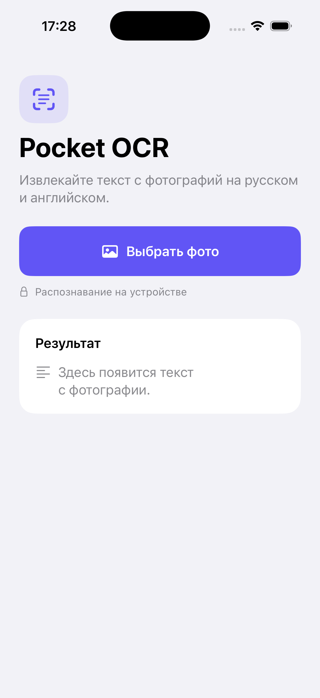

# Pocket OCR

Небольшое приложение на SwiftUI для iPhone и iPad. Выберите фото, дождитесь распознавания и скопируйте текст. Apple Vision обрабатывает русский и английский на устройстве. Приложение получает только выбранное фото и передаёт Vision ориентацию из метаданных изображения.

## Запуск

1. Откройте `Pocket OCR.xcodeproj` в Xcode 16 или новее.
2. Выберите схему **Pocket OCR** и симулятор iPhone или iPad с iOS 17 или новее. Для запуска на своём устройстве укажите команду разработчика в **Signing & Capabilities**.
3. Нажмите **⌘R**. Для проверки перенесите в окно Simulator изображение с русским и английским текстом, затем выберите его в приложении.

Внешние пакеты и ключи не требуются. Если выбрать другое фото во время обработки, предыдущая задача отменяется и её результат не появится на экране. Закрытие окна выбора сохраняет текущий результат.

## Проверка

Сборка выполнена в Xcode 26.6 с SDK iOS 26.5 для устройства и симулятора. На iPhone 17 Pro с iOS 26.2 проверены запуск, распознавание кириллицы и латиницы на одном снимке, подтверждение копирования, отмена выбора и сообщение для фото без текста. Скриншот снят в этом же симуляторе.

Отдельно проверены ошибка для повреждённых данных и отмена задачи распознавания. Выбор нового фото до завершения предыдущего распознавания и повёрнутое фото с EXIF-ориентацией вручную в симуляторе не проверялись.
